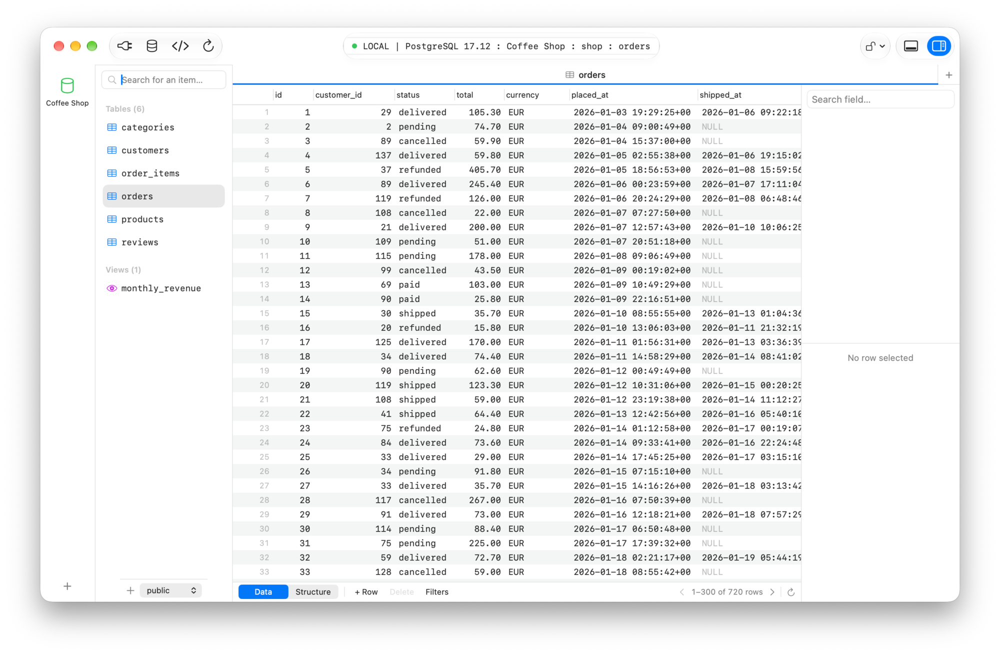
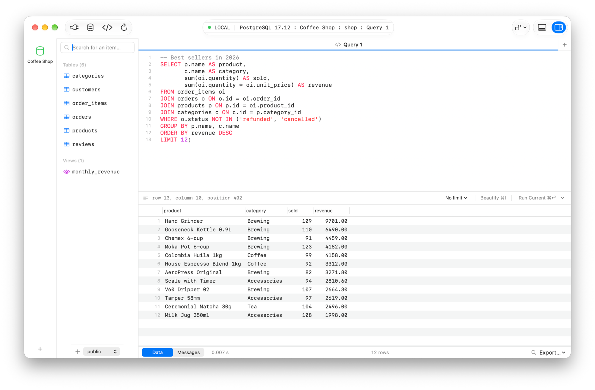
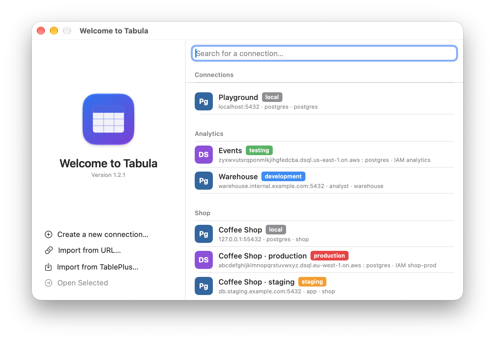

<div align="center">
  
  <h1>Tabula</h1>
  <p><strong>A native macOS client for PostgreSQL and Amazon Aurora DSQL, modeled on TablePlus.</strong></p>

[](https://github.com/andreabasile/tabula/releases/latest)
[](https://github.com/andreabasile/tabula/actions/workflows/ci.yml)

[](LICENSE)

</div>

<p align="center">
  
</p>

Tabula connects to PostgreSQL and to Aurora DSQL from the same window. With DSQL there is no password to
paste: Tabula generates the IAM token with the AWS CLI and the profile you choose (SSO, assume-role or keys),
renews it on its own and reconnects before DSQL's 60-minute limit.

## Features

- **PostgreSQL and Aurora DSQL**, with IAM tokens created and renewed for you.
- **Tunnels that look after themselves.** A pre-connection script, such as an SSM tunnel, starts when the
  connection needs it, restarts when it drops and stops when the last window using it closes.
- **Import from TablePlus**: connections, groups, tags, SSL, safe mode and passwords, from an encrypted export.
- **SQL editor** with syntax highlighting, completion of tables, columns and aliases, Beautify, and running
  the current statement or the whole script.
- **Edit data in the grid**, then save all changes with ⌘S. Filters, a row detail panel, and export to CSV,
  JSON, Markdown or `INSERT` statements.
- **Colored tags and safe mode**, so a production connection looks different and can ask before every query
  or every write.
- **Passwords in the Keychain**, never in the connections file.
- **In English, Italian, French and German**, following the macOS system language.

<table>
  <tr>
    <td width="50%"></td>
    <td width="50%"></td>
  </tr>
  <tr>
    <td align="center">SQL editor and results</td>
    <td align="center">Saved connections, grouped and tagged</td>
  </tr>
</table>

## Install

With [Homebrew](https://brew.sh):

```sh
brew install --cask andreabasile/tap/tabula
```

Or download the DMG from [Releases](https://github.com/andreabasile/tabula/releases/latest).

- Apple Silicon only, macOS 15 or later. libpq is bundled in the app.
- Aurora DSQL connections need the [AWS CLI v2](https://aws.amazon.com/cli/), for example in
  `/opt/homebrew/bin/aws` or `/usr/local/bin/aws`.
- The app is self-signed and not notarized. The cask removes the quarantine attribute after installing it.
  With the DMG, allow it once in System Settings › Privacy & Security › Open Anyway, or run
  `xattr -dr com.apple.quarantine /Applications/Tabula.app`.
- At launch Tabula checks GitHub for a newer release and, if there is one, shows the update command once
  (`brew upgrade --cask tabula`).

## How it works

### Aurora DSQL tokens

- `CachedTokenProvider` reuses a token until less than a minute of it is left. The token is only needed to
  open the connection, which then stays valid.
- `ManagedSession` recreates the connection after 55 minutes, as the AWS connectors do, and whenever it drops:
  reads are retried, writes are not.
- If DSQL rejects a cached token, Tabula generates a new one and retries once.
- The status bar shows how long the token is valid, how long the connection has been open and how many times
  it reconnected. **Reconnect** (⇧⌘R) forces a new token and a new connection.

### Pre-connection scripts and tunnels

Each connection can have a script, saved with it, that Tabula runs in a zsh login shell before connecting:
for example `bash ~/scripts/db-tunnel-prod.sh` for an SSM tunnel.

- **Opens a tunnel** (the default): the script may keep running. Tabula launches it only if host and port are
  not already answering, waits for them to answer (30 s by default), relaunches it when the tunnel drops and
  the connection has to be recreated, and kills its whole process tree when the last window using it closes
  or the app quits. Connections on the same port share one tunnel.
- Otherwise the script must exit successfully before every connection, for example `aws sso login`.

If the script fails, the error shows the last lines of its output. Imports from TablePlus carry over its
`StartupBashScript`.

### Import from TablePlus

**Import from TablePlus…** in the welcome window reads the file made with File › Export Connections in
TablePlus (encrypted with RNCryptor v3 and the password chosen at export) and shows a preview first. Groups,
tags, SSL, safe mode and passwords come across, passwords into the Keychain. Connections you already have,
with the same host, port, user and database, start unselected.

### Several connections at once

As in TablePlus, open connections sit in the column on the left of the window, each icon in the color of its
tag: ⌘K opens another one and ⌘1…⌘9 switch between them. On PostgreSQL, ⌘D opens another database on the same
server. The box in the middle of the toolbar takes the tag's color too; click it for host, user, token and the
Reconnect and Disconnect buttons.

## Keyboard shortcuts

| Shortcut | Action |
|---|---|
| ⌘K | Open a connection |
| ⌘1…⌘9 | Switch connection |
| ⌘D | Open another database |
| ⇧⌘0 | Manage connections |
| ⌘T | New query |
| ⌘↩ | Run the current statement or the selection |
| ⇧⌘↩ | Run all |
| ⌘I | Beautify |
| ⌘S | Save changes |
| ⌘F | Filters |
| ⌘P | Find a table |
| ⌘R | Refresh |
| ⇧⌘R | Reconnect |
| ⇧⌘C | Console |
| ⌘] | Row detail |

## Development

```sh
brew install libpq   # needed to build
swift test           # core tests
swift run Tabula     # run from source
```

[CONTRIBUTING.md](CONTRIBUTING.md) covers requirements, building the app, translations, the development hooks
and the known limitations. Report security issues as described in [SECURITY.md](SECURITY.md).

## License

MIT, see [LICENSE](LICENSE).

Tabula is not affiliated with TablePlus or Amazon Web Services; their names and trademarks belong to their
owners. The data in the screenshots is made up.
